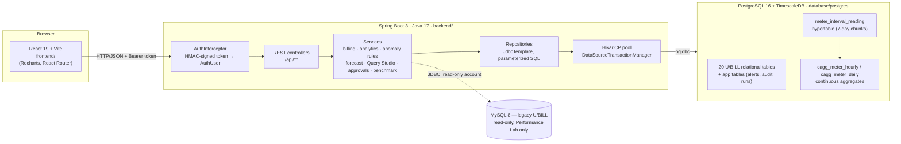

# GridPulse — System Architecture

GridPulse is the upgraded U/BILL. The browser talks only to the Java backend; the
backend talks to one PostgreSQL database that has the TimescaleDB extension. The
old MySQL database is kept only as a read-only baseline for the Performance Lab.

## Layers

| Layer | Responsibility | Location |
|---|---|---|
| React frontend | Pages, charts, forms. Shows or hides admin controls, but never decides access. | `frontend/src` |
| `AuthInterceptor` | Rejects every `/api/**` call without a valid signed token (HTTP 401) before any SQL runs. | `backend/.../security` |
| Controllers | Parse and validate parameters, map errors to HTTP status codes, keep the U/BILL `{success, data, message}` envelope. | `backend/.../controller` |
| Services | Business rules: tariff pricing, bill generation, interval-reading capture, consumption analytics, anomaly rules, forecasting, Query Studio classification and approvals, benchmarking. Role checks (`requireAdmin`). Transactions. | `backend/.../service` |
| Repositories | All SQL, always with `?` parameters. No JPA/Hibernate. | `backend/.../repository` |
| PostgreSQL | Constraints, foreign keys, least-privilege roles for Query Studio. | `database/postgres` |
| TimescaleDB | Hypertable partitioning, `time_bucket`, continuous aggregates and their refresh jobs. | `database/postgres/04, 05, 09` |

## Request flow examples

**Daily consumption chart:** `GET /api/analytics/consumption?meterId=1001&interval=day&from=…&to=…`
→ `AnalyticsController` validates the meter, range and interval → `ConsumptionService`
picks the source (hourly → `cagg_meter_hourly`, day/week/month → `cagg_meter_daily`) →
`AnalyticsRepository` runs a parameterized query → missing buckets are returned as
`missing: true` (not zero).

**Approve a Query Studio write:** `POST /api/query/requests/{id}/approve` with
`{approvalPassword}` → token must be ADMIN → `ApprovalService` checks the approval
password and writes an `approval_audit` row → the request is locked `FOR UPDATE`,
re-classified on the server, and executed in **one transaction** as the restricted
role `gridpulse_query_writer` → COMPLETED or FAILED (rolled back).

**Projected bill:** `GET /api/bills/estimate/{meterId}` → `BillForecastService` reads the
current period's daily totals from `cagg_meter_daily`, the meter's tariff and utility
service → `ForecastCalculator` extrapolates → `TariffCalculator` prices it → response is
flagged `is_estimate: true`. Nothing is written to `bill`.

## What changed from U/BILL

| Area | U/BILL | GridPulse |
|---|---|---|
| Backend | Node.js + Express, mysql2 | Java 17 + Spring Boot 3, JDBC (`JdbcTemplate`, HikariCP) |
| Database | MySQL 8 | PostgreSQL 16 + TimescaleDB (MySQL only as benchmark baseline) |
| Auth | JWT, bcrypt hash for admin from `.env`, public registration | HMAC-signed token, two fixed demo accounts compared in plain text (brief requirement), registration disabled |
| Unprotected routes | All CRUD/dashboard routes were public | Every route except login/health requires a token; writes are ADMIN-only |
| Approvals | Query approvals did not check the approval token | Approval password required and audited on every approve/reject |
| Query Studio reads | Full-privilege connection, `multipleStatements: true` | One statement, read-only transaction, restricted role, 5 s timeout, 1,000-row cap |
| Bill amount | Not stored or computed (UI showed ₹0) | Derived by `TariffCalculator` (see [BILLING_RULES.md](BILLING_RULES.md)) |
| Time series | 3 monthly reads per meter | 15-minute interval readings in a hypertable + continuous aggregates |

Diagrams of the data model are in [DATABASE.md](DATABASE.md).
