# Database Reference — EER model and relational schema

GridPulse keeps the U/BILL relational design (20 domain tables, same keys, same
constraint names) and adds one time-series table plus a few application tables.
Everything lives in one PostgreSQL 16 database (`gridpulse`) with the TimescaleDB
extension. Scripts: [`database/postgres/`](../database/postgres) (run in file order).

Related: [TIMESCALEDB.md](TIMESCALEDB.md) (hypertable and continuous aggregates),
[DATABASE_MIGRATION.md](DATABASE_MIGRATION.md) (MySQL → PostgreSQL), [BILLING_RULES.md](BILLING_RULES.md).

## EER model (updated)

```mermaid
erDiagram
    CUSTOMER ||--o{ CUSTOMER_PHONE : has
    CUSTOMER ||--o{ CUSTOMER_EMAIL : has
    CUSTOMER ||--o{ CUSTOMER_OWNS_PROPERTY : owns
    PROPERTY ||--o{ CUSTOMER_OWNS_PROPERTY : "owned by"
    PROPERTY ||--o{ PROPERTY_INCORPORATE_METER : incorporates
    METER ||--|| PROPERTY_INCORPORATE_METER : "installed in"
    METER ||--o{ METER_READING : "billing-cycle reads"
    METER ||--o{ METER_INTERVAL_READING : "15-min reads (hypertable)"
    METER ||--o{ METER_SERVICE : uses
    UTILITY_SERVICE ||--o{ METER_SERVICE : "provided to"
    UTILITY_SERVICE ||--o| ELECTRICITY_SERVICE : "ISA"
    UTILITY_SERVICE ||--o| WATER_SERVICE : "ISA"
    METER ||--o{ BILL : billed
    TARIFF ||--o{ BILL : prices
    BILL ||--o{ PAYMENT : "paid by"
    PAYMENT_SCHEDULE ||--o{ PAYMENT : "instalment of"
    PAYMENT ||--o| CARD_PAYMENT : "ISA"
    PAYMENT ||--o| CASH_PAYMENT : "ISA"
    PAYMENT ||--o| UPI_PAYMENT : "ISA"
    CARD ||--o{ CARD_PAYMENT : charged
    METER ||--o{ CONSUMPTION_ALERT : raises
    APP_USERS ||--o{ QUERY_REQUEST : submits
    APP_USERS ||--o{ APPROVAL_AUDIT : "acts in"

    CUSTOMER { int cust_id PK
        varchar cust_name
        varchar apartment
        varchar flat_no
        varchar city
        date dob }
    PROPERTY { int property_id PK
        varchar property_name
        varchar occupancy_status }
    METER { int meter_id PK
        numeric capacity
        date installation_date
        varchar meter_status }
    METER_READING { int meter_id PK,FK
        int reading_no PK
        date reading_date
        numeric reading_value }
    METER_INTERVAL_READING { int meter_id PK,FK
        timestamptz reading_time PK
        numeric register_value
        numeric interval_consumption
        int interval_minutes
        bool register_reset }
    UTILITY_SERVICE { int service_id PK
        numeric fixed_charge
        numeric unit_rate
        numeric tax }
    TARIFF { varchar tariff_code PK
        numeric unit_rate }
    BILL { int meter_id PK,FK
        date billing_month PK
        int bill_id UK
        numeric previous_reading
        numeric current_reading
        varchar tariff_code FK
        varchar bill_status }
    PAYMENT { int bill_id PK,FK
        int payment_sequence PK,FK
        int payment_id UK
        date payment_date
        numeric amount
        varchar payment_mode }
    CONSUMPTION_ALERT { bigint alert_id PK
        int meter_id FK
        varchar alert_type
        varchar severity
        timestamptz observation_start
        numeric deviation_pct
        varchar status }
```

Specializations are unchanged from U/BILL: `UTILITY_SERVICE` → `ELECTRICITY_SERVICE` /
`WATER_SERVICE` (disjoint), `PAYMENT` → `CARD_PAYMENT` / `CASH_PAYMENT` / `UPI_PAYMENT`
(disjoint, discriminated by `payment.payment_mode`).

## Relational schema

Underlined = primary key, *italic* = foreign key. `[TS]` = TimescaleDB object.

### U/BILL domain (converted, 20 tables)

| Relation | Attributes | Notes |
|---|---|---|
| customer | <u>cust_id</u>, cust_name, apartment, flat_no, city, dob | |
| customer_phone | <u>*cust_id*, phone_no</u> | multivalued attribute |
| customer_email | <u>*cust_id*, email</u> | multivalued attribute |
| property | <u>property_id</u>, property_name, occupancy_status | CHECK Occupied/Vacant |
| customer_owns_property | <u>*cust_id*, *property_id*</u>, ownership_date, ownership_type | M:N |
| meter | <u>meter_id</u>, capacity, installation_date, meter_status | CHECK capacity > 0, status list |
| property_incorporate_meter | *property_id*, <u>*meter_id*</u> | 1:N (meter in one property) |
| meter_reading | <u>*meter_id*, reading_no</u>, reading_date, reading_value, reading_status | billing-cycle reads, cumulative register; **new** UNIQUE (meter_id, reading_date) |
| utility_service | <u>service_id</u>, fixed_charge, unit_rate, tax | supertype |
| electricity_service | <u>*service_id*</u>, voltage_level | subtype |
| water_service | <u>*service_id*</u>, water_source | subtype |
| meter_service | <u>*meter_id*, *service_id*</u> | M:N |
| tariff | <u>tariff_code</u>, unit_rate | flat per-unit rate |
| bill | <u>*meter_id*, billing_month</u>, bill_id UNIQUE, billing_date, previous_reading, current_reading, *tariff_code*, bill_status | **new** CHECK billing_month is the 1st |
| payment_schedule | <u>payment_sequence</u>, payment_due_date | |
| payment | <u>*bill_id*, *payment_sequence*</u>, payment_id UNIQUE, payment_date, amount, payment_mode | CHECK amount > 0, mode list |
| card | <u>card_no</u>, bank_name | |
| card_payment | <u>*payment_id*</u>, *card_no* | subtype |
| cash_payment | <u>*payment_id*</u>, receipt_no UNIQUE | subtype |
| upi_payment | <u>*payment_id*</u>, upi_id, upi_app | subtype |

### GridPulse additions

| Relation | Attributes | Notes |
|---|---|---|
| meter_interval_reading `[TS]` | <u>*meter_id*, reading_time</u>, register_value, interval_consumption, interval_minutes, reading_quality, register_reset, data_source | hypertable on `reading_time`, 7-day chunks |
| cagg_meter_hourly `[TS]` | meter_id, bucket, total_consumption, reading_count, covered_minutes, max_interval_minutes, max_interval_consumption, min/max_register, has_reset, non_valid_count | continuous aggregate, 1 hour (IST) |
| cagg_meter_daily `[TS]` | same columns | continuous aggregate, 1 day (IST) |
| consumption_alert | <u>alert_id</u>, *meter_id*, alert_type, severity, observation_start/end, observed_consumption, baseline_average, deviation_pct, baseline window, explanation, recommended_action, status, rule_version, thresholds (JSONB), reviewed/resolved by/at, status_note | UNIQUE (meter_id, observation_start, alert_type) prevents duplicates |
| app_users | <u>user_id</u>, username UNIQUE, role, created_at, updated_at, last_login_at | no password column — passwords are never stored |
| access_requests | <u>request_id</u>, requested_by, operation, target_table, record_id, request_data (JSONB), reason, status, reviewer fields | ported from U/BILL |
| query_request | <u>request_id</u>, *submitted_by*, *reviewed_by*, sql_query, query_type, status, timestamps, rejection_reason, execution_result | lifecycle CHECK PENDING → APPROVED → EXECUTING → COMPLETED/FAILED, or REJECTED |
| approval_audit | <u>audit_id</u>, *admin_user_id*, admin_username, action, target_type, target_id, outcome, detail, created_at | every approve/reject/verify attempt; never the password |
| benchmark_run | <u>run_id</u>, started/finished_at, *triggered_by*, status, repetitions, warmup_runs, environment (JSONB), results (JSONB) | measured Performance Lab runs |
| v_meter_profile (view) | meter + property + owners + service type + unit | kWh for electricity meters, kL for water meters |

## Indexes added

PostgreSQL does not index foreign-key columns automatically (InnoDB does), so the FK
columns used in joins got explicit indexes: `customer_owns_property(property_id)`,
`property_incorporate_meter(property_id)`, `meter_service(service_id)`, `bill(tariff_code)`,
`payment(payment_sequence)`, `payment(payment_date)`, `card_payment(card_no)`. The
hypertable has its primary key `(meter_id, reading_time)` plus TimescaleDB's default
`(reading_time DESC)` index; each continuous aggregate has a `(meter_id, bucket)` index.

## Database roles

| Role | Used by | Privileges |
|---|---|---|
| `gridpulse_app` | backend connection pool | owns all objects |
| `gridpulse_query_reader` | Query Studio reads (`SET LOCAL ROLE`) | SELECT on the 20 domain tables, interval readings, alerts, continuous aggregates and `v_meter_profile` — explicitly no access to `app_users`, `access_requests`, `query_request`, `approval_audit`, `benchmark_run` |
| `gridpulse_query_writer` | approved Query Studio writes | same reads + INSERT/UPDATE/DELETE on the 20 domain tables only (not interval readings, alerts or application tables) |

## Verification

`database/postgres/99_validation.sql` prints PASS/WARN/FAIL rows: extension and
hypertable present, continuous aggregates populated, row counts, orphan checks, billing-cycle
readings equal the interval register at local midnight, Query Studio role privileges,
and the two known legacy data warnings (payment 9008 is UPI but
has a card row; legacy payments do not match any amount formula).
